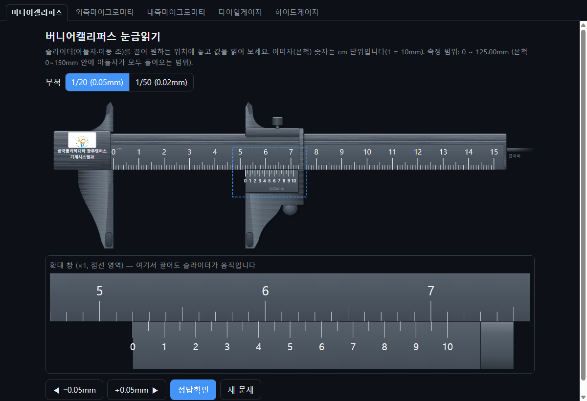
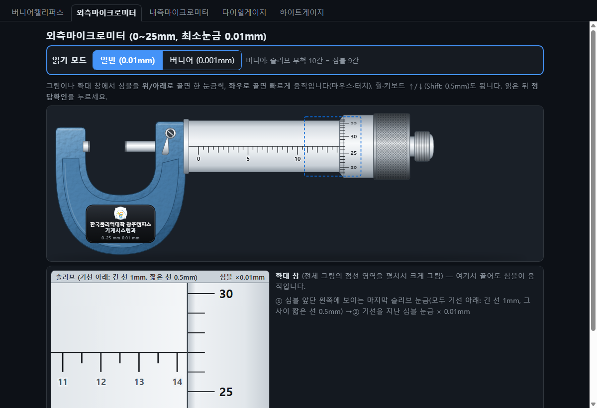
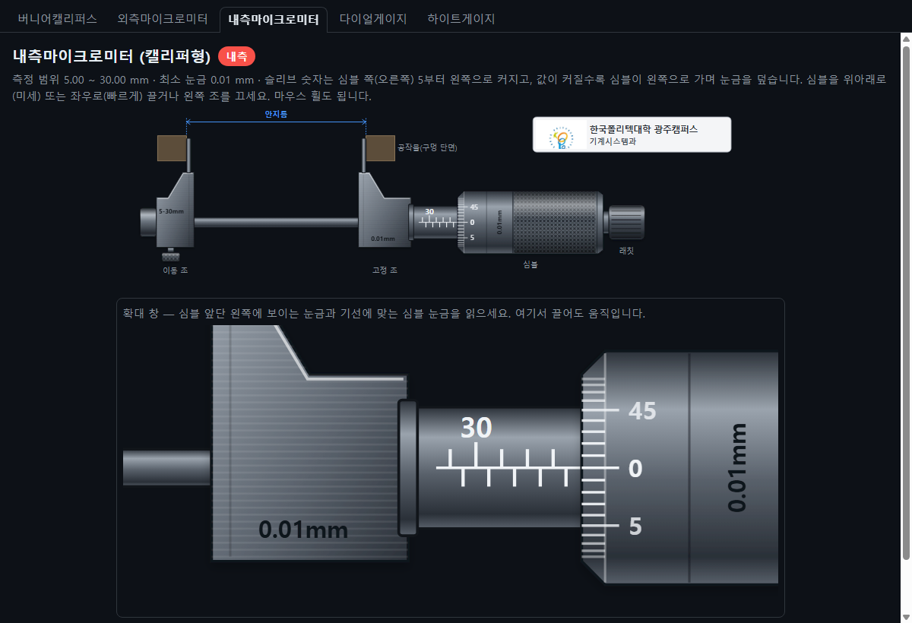
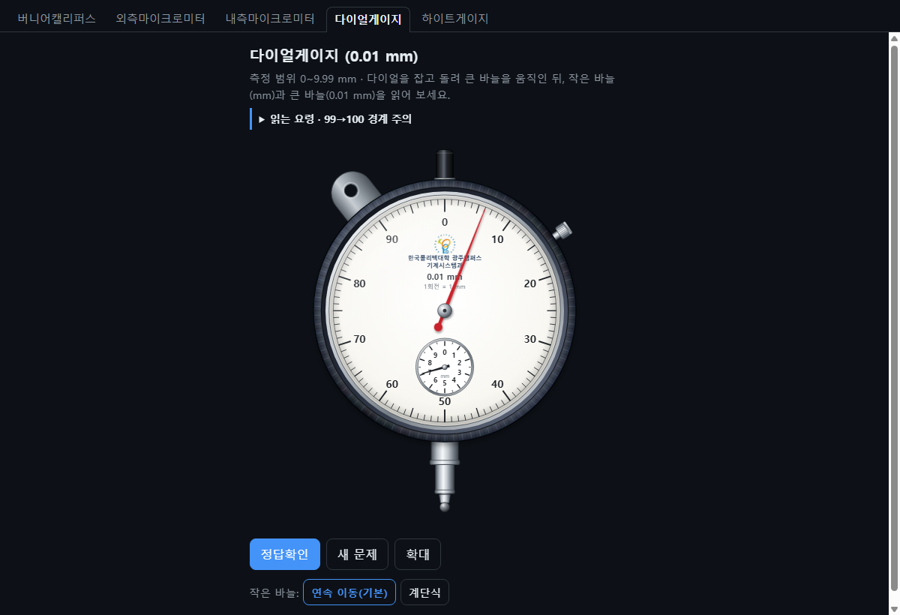
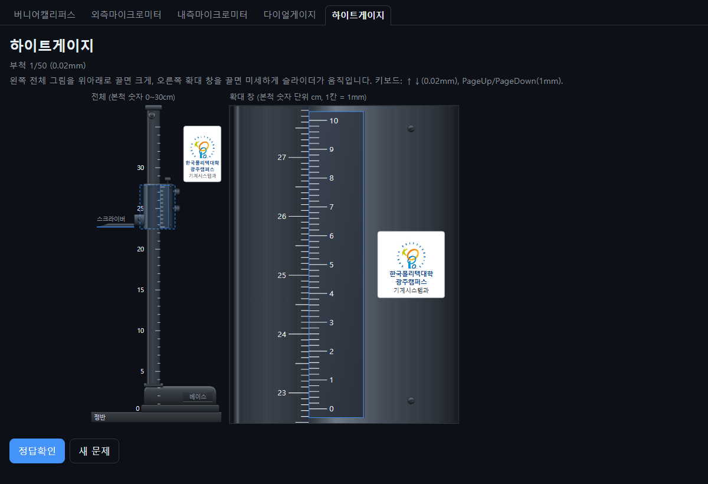

# 정밀측정 눈금읽기 연습

**한국폴리텍대학 광주캠퍼스 기계시스템과** 정밀측정 수업용 눈금읽기 연습 도구입니다.
계측기의 슬라이더·심블·바늘을 마우스(또는 터치)로 움직여 눈금을 읽고, **정답확인** 버튼으로 값과 계산 과정을 확인합니다.

## 🔗 바로 사용하기

### 👉 https://kgh-dac.github.io/gauge-trainer/

| 계측기 | 최소눈금 | 단독 페이지 |
| --- | --- | --- |
| 버니어캘리퍼스 | 0.05mm / 0.02mm | [vernier.html](https://kgh-dac.github.io/gauge-trainer/vernier.html) |
| 외측마이크로미터 | 0.01mm / 0.001mm | [outside-mic.html](https://kgh-dac.github.io/gauge-trainer/outside-mic.html) |
| 내측마이크로미터 | 0.01mm | [inside-mic.html](https://kgh-dac.github.io/gauge-trainer/inside-mic.html) |
| 다이얼게이지 | 0.01mm | [dial.html](https://kgh-dac.github.io/gauge-trainer/dial.html) |
| 하이트게이지 | 0.02mm | [height.html](https://kgh-dac.github.io/gauge-trainer/height.html) |

## 사용 방법
1. 위쪽 탭에서 계측기를 선택합니다.
2. 슬라이더·심블·바늘을 드래그하거나 버튼/키보드로 움직여 눈금을 읽습니다.
3. **정답확인**을 눌러 값과 계산 과정을 확인합니다.
4. **새 문제**를 누르면 무작위 위치에서 다시 연습할 수 있습니다.

## 화면

### 버니어캘리퍼스

### 외측마이크로미터

### 내측마이크로미터

### 다이얼게이지

### 하이트게이지

## 구성
- `index.html` — 5종 통합 페이지(탭형)
- `vernier.html`, `outside-mic.html`, `inside-mic.html`, `dial.html`, `height.html` — 계측기별 단독 페이지(노션 임베드용)
- 모든 페이지는 외부 라이브러리 없는 단일 HTML(SVG + JS)입니다.
